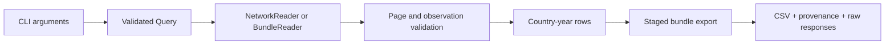

# Understanding and maintaining EcoEvidence

EcoEvidence has one job: turn a reviewed country/year query into an auditable evidence bundle. The scientific boundary is explicit: it retrieves and validates source data, but does not estimate missing observations or interpret an association as a causal effect.

## Data flow

| Boundary | Responsibility | Code |
| --- | --- | --- |
| User input | Normalize country order and case; reject unsupported indicators and years | `cli.py`, `Query` |
| Reviewed definitions | Identify each indicator, its units and source | `registry.py` |
| Source transport | Enforce HTTPS origin, redirect and request budgets; preserve raw bytes and retrieval times | `NetworkReader`, `OfficialRedirectHandler` |
| Local archive | Read bounded regular files, validate the manifest and raw hashes, confine raw paths to the bundle | `BundleReader`, `read_bounded_file` |
| JSON and schema | Reject ambiguous object keys, invalid numeric/text values, unexpected identities, duplicates and inconsistent pagination | `decode_json`, `fetch_pages`, `collect` |
| Transformation | Produce one row per requested country-year, keeping source zero, explicit null and omitted rows distinct | `collect` |
| Publication | Prepare a complete bundle in a sibling temporary directory, then rename it into place | `export_bundle` |

These functions remain in a small core module because they implement one workflow and share one error contract. Readers are passed into collection/export, so offline tests can supply exact bytes without replacing the scientific transformation. The CLI owns presentation and exit codes. Package metadata and provenance use the version in `eco_evidence.__version__`.

`panel.py` composes two or three distinct archived indicators. It validates each recorded canonical query and delegates raw-response validation to `BundleReader` and `collect`. A frozen in-memory reader then supplies those verified snapshots to the existing exporter for self-contained embedded bundles. This keeps source validation in one place and avoids re-reading mutable raw input files while publishing. The original input CSV is not consumed. A sorted outer union preserves every requested country-year key, adds `not_requested` for each unmatched indicator, and counts coverage before staging the final output. See [the panel contract](PANELS.md) for lineage, limits and interpretation. The acquisition module and the daily scheduler do not gain new responsibilities.

`archive.py` shares canonical-query reconstruction between panels and `inspection.py`. Inspection reads the verified snapshots and reconstructed rows, qualifies catalog-level licensing separately, and optionally compares two identical queries and origins. It compares source update labels independently from exact decimal values, missingness, names and flags. No export timestamp is used to infer a data revision. Report generation is deterministic and read-only; the text renderer escapes source strings. See [the inspection contract](INSPECTION.md) for counts, source-date interpretation and report limits.

## What is trusted

Online requests are limited to `https://api.worldbank.org` on the default HTTPS port. TLS verification remains enabled. A redirect is checked before the destination is contacted; a final-response origin check remains as a second check. Redirects use the same request budget as initial requests.

The API's content is still validated. A valid transport connection does not prove that its rows, units, names or pagination are suitable for the requested query. The registry checks names and source identity. Metadata and observation unit fields must retain the reviewed blank value; populated or changed fields require registry review. Observation checks reject unexpected country/year pairs, and a reported database revision label must be a real calendar date in `YYYY-MM-DD` form. Source revisions can still occur between independent requests; use fresh retrievals for a current research snapshot and archive the results.

WDI's complete no-records response is a specific exception: on the first requested page, `page`, `pages`, `per_page` and `total` are integer zero; `sourceid`, `lastupdated` and the data payload are null. This exact envelope produces the full requested country-year grid with `not_returned` status and empty values. Country/indicator metadata must still validate, including WDI identity and the curated unit assumption. Provenance retains the validated dataset identity and records `last_updated: null`; it does not fabricate a source revision. A zero marker in a later page, a partial marker or nonempty data with zero counts is an error.

An offline manifest is **not a source signature**. Hashes detect a mismatch between the manifest and files, but a person who can change both can manufacture a coherent bundle. Use a trusted custodian and version history. Replay validates the raw-source hashes and reconstructs the CSV from those responses; it does not read or verify the earlier `data.csv`. Compare CSVs when auditing whether an earlier derived file changed. Raw source paths must resolve inside the bundle. All local inputs must be regular files within the size limits; a pipe or device is rejected before reading its contents.

CSV is a plain data interchange format. Names and observation flags are source text, not executable instructions. When using spreadsheet software, import text columns as text rather than enabling formula interpretation for external data. EcoEvidence does not launch spreadsheets or execute data.

## Enforced limits and remaining limits

| Limit | Enforced value |
| --- | --- |
| Countries/economies per query | 1–20 distinct three-letter codes recognized by WDI country metadata |
| Years | 1960 through the current UTC year |
| Network requests | 30 per reader, including followed redirects |
| Pages | 10 per endpoint |
| Raw response | 5,000,000 bytes, online or archived |
| Cache envelope | 7,000,000 bytes, including base64 data |
| Bundle manifest, reading and writing | 1,000,000 bytes |
| Country name repeated in CSV | 1,024 UTF-8 bytes |
| Observation flag text | 256 UTF-8 bytes |
| Socket-operation timeout | 1–30 seconds, default 15 |

The network timeout applies to blocking operations, not an overall download deadline. The byte and request limits bound accepted input; they are not a promise of a particular peak memory use. A hard interruption can leave a hidden export staging directory or a temporary cache file, although normal failure paths remove them. The final rename is atomic on the same filesystem; callers must not concurrently replace the output path or modify an input archive while it is being read. Existing nonempty bundles are preserved, and the CLI refuses an already-existing output path.

## Failure behavior

Input and source failures become `EvidenceError`. The CLI prints a short diagnostic on stderr and exits with status 2. Operating-system failures also exit 2. Programmer errors are not swallowed by a broad exception handler. Source JSON is parsed with exact decimal values and a duplicate-key check; unrepresentable decimal exponents, non-finite constants and invalid Unicode text are rejected.

No invented fallback data is substituted after a failed fetch. A final bundle appears only after validation and writing succeed. A failed cache replacement keeps the prior file and removes the new temporary file. An invalid cache entry is a visible failure with a `--refresh` recovery instruction.

## Maintenance workflow

1. Reproduce a problem through the CLI or a narrowly scoped source fixture before editing. Keep synthetic fixtures explicitly labeled.
2. State the invariant that should hold: identity, units, coverage, no network during offline replay, bounded input, or preservation of earlier evidence.
3. Fix the responsible boundary and add a regression that fails on the previous behavior. Do not replace a behavior check with a test that only repeats implementation details.
4. Run the core tests and a representative CLI retrieval/replay. If networking changes, verify all registered indicators against the real API with TLS enabled.
5. Obtain the independent Claude review required by `AGENTS.md`; address material findings, then verify the finished change on the supported CI Python versions. CI builds and installs a wheel, runs `scripts/check_installed.py` with isolated Python mode outside the source checkout, then runs the core and routine suites. The installed check exercises the console command, version parity, synthetic offline replay, hashes/status distinctions and preservation of an earlier output. It also composes the seven-row synthetic panel and reconstructs identical CSV and coverage files from its embedded inputs.
6. Keep historical example bundles intact. A new source acquisition gets a new directory and timestamps. A code change gets a version update so later provenance identifies its behavior.

The installed check also inspects an archived replay, compares the revised synthetic population fixture, checks its two status transitions and one numerical revision despite an unchanged update label, and rejects an incompatible baseline without changing inputs. Inspection regressions exercise definition/provider differences, exact decimal equivalence, unknown source updates, raw-response changes and corrupt archives.

The daily scheduler is a separate local operations helper described in [DAILY_ROUTINE.md](DAILY_ROUTINE.md). Research ingestion changes do not require changing the active schedule or its local work record.

CI's direct third-party actions are referenced by immutable commit IDs. When updating them, check the official repository/release, review the change and retain the least permissions needed. Pinning these direct actions does not freeze their transitive dependencies or the build backend; treat successful clean-wheel checks as release evidence rather than assuming a tag or pin proves the whole dependency chain.

CI keeps the Python 3.11/3.13 Linux checks and adds a Python 3.13 macOS job. The macOS run exercises directory aliases that depend on filesystem case and Unicode-normalization behavior; those tests skip when the temporary filesystem treats the spellings as distinct. All jobs build and exercise the installed distribution before running project and routine tests.

## Engineering references

- Python's [JSON documentation](https://docs.python.org/3/library/json.html) explains numeric customization, repeated-name behavior and the need to limit untrusted input sizes.
- [RFC 8259, section 4](https://www.rfc-editor.org/rfc/rfc8259#section-4) describes interoperability problems with repeated object names. EcoEvidence chooses to reject ambiguity.
- Python's [urllib documentation](https://docs.python.org/3/library/urllib.request.html) defines redirect handlers and blocking-operation timeouts. These mechanisms are exercised by the transport tests.
